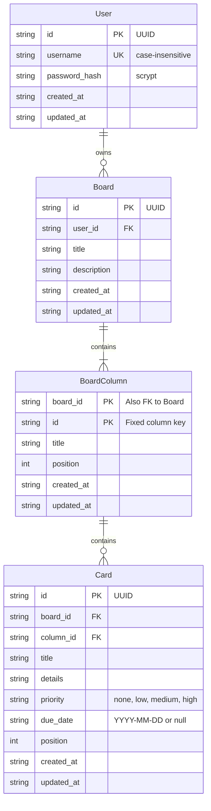

# SQLite data model

One SQLite database stores users, their boards, each board's fixed columns, and
cards. The [JSON Schema](./schema.json) documents the row shapes; SQLite
constraints are authoritative for relationships and uniqueness. The schema
version is tracked with `PRAGMA user_version` (currently 2).

## Entities and relationships

<!-- mermaid-checked: every attribute is `<type> <name> [<key>] ["<description>"]` with at most one of PK/FK/UK, no \n in descriptions, no {} in descriptions, every relationship label is double-quoted -->

## Tables and constraints

| Table | Keys and constraints |
|---|---|
| `users` | UUID `id`. `username` is unique case-insensitively. `password_hash` uses the format `scrypt$<salt>$<digest>`. |
| `boards` | UUID `id`. `user_id` references `users.id` (indexed); a user may own any number of boards. `title` 1-120 chars, `description` up to 500. |
| `board_columns` | Primary key (`board_id`, `id`). Each board has the five fixed columns `backlog`, `up-next`, `in-progress`, `in-review`, `done` at positions 0-4. Titles (1-80 chars) can be renamed. |
| `cards` | UUID `id`. (`board_id`, `column_id`) references the board's column; (`board_id`, `column_id`, `position`) is unique. `priority` is one of `none`, `low`, `medium`, `high`; `due_date` is a valid ISO date or null. |

Timestamps are UTC ISO 8601 strings. Foreign keys are enabled on every
connection. Deleting a user cascades to their boards, and deleting a board
cascades to its columns and cards. Moves and deletes renormalize card positions
in the same transaction, temporarily shifting positions to avoid collisions with
the unique constraint.

## Ownership

Every board query and mutation is filtered by both the board ID and the
authenticated user's ID taken from the server-side session, so a user can
neither read nor change another user's board; such requests return 404.

## Initialization and migration

- The default path is `backend/data/pm.sqlite3` (Docker: `/app/data` in the
  `pm-mvp-data` volume); `DATABASE_PATH` overrides it.
- A new database gets the version 2 schema and the seeded `user` / `password`
  account with a sample "Product launch" board. Accounts created through
  registration start with an empty "My first board".
- A version 1 database (one board per user, no passwords) is migrated in one
  transaction: `users.password_hash` is added and set for the seeded `user`;
  `boards` is rebuilt without the one-board-per-user constraint and gains
  `description`; `cards` gains `priority` and `due_date`. Existing rows are
  kept, and `PRAGMA foreign_key_check` must pass before the version is bumped.
- A database newer than the supported version is rejected at startup.

## Conversation history

AI chat history is not persisted. The browser keeps it per board while the page
is open and sends up to 20 prior messages with each request.

## Authentication scope

Passwords are hashed with the standard library's scrypt. Sessions are random
tokens in an HttpOnly cookie, held in backend memory for 12 hours and lost on
restart. Changing the password signs out the user's other sessions; deleting
the account removes all of its sessions and data.
