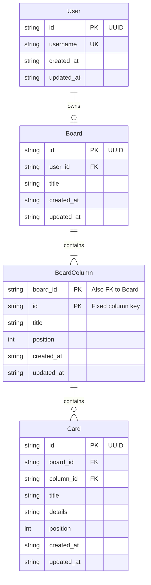

# SQLite data model proposal

This proposal stores users, their boards, fixed board columns, and cards in one
SQLite database. The relational model is intended for the local single-container
MVP and keeps ownership and ordering enforceable by the database.

The accompanying [JSON Schema](./schema.json) describes a JSON snapshot of these
records. It documents the row shapes; SQLite constraints remain authoritative for
relationships and uniqueness across rows.

## Entities and relationships

<!-- mermaid-checked: every attribute is `<type> <name> [<key>] ["<description>"]` with at most one of PK/FK/UK, no \n in descriptions, no {} in descriptions, every relationship label is double-quoted -->


## Proposed tables

| Table | Fields | Keys and constraints |
|---|---|---|
| `users` | `id`, `username`, `created_at`, `updated_at` | `id` is a UUID primary key. `username` is required and unique, case-insensitively. |
| `boards` | `id`, `user_id`, `title`, `created_at`, `updated_at` | `id` is a UUID primary key. `user_id` is a required foreign key to `users.id` and is unique, enforcing at most one board per user. |
| `board_columns` | `board_id`, `id`, `title`, `position`, `created_at`, `updated_at` | Composite primary key (`board_id`, `id`); `board_id` references `boards.id`. `id` is one of `backlog`, `up-next`, `in-progress`, `in-review`, or `done`. `position` is unique within a board and constrained to 0–4. |
| `cards` | `id`, `board_id`, `column_id`, `title`, `details`, `position`, `created_at`, `updated_at` | `id` is a UUID primary key. (`board_id`, `column_id`) references the matching board column. (`board_id`, `column_id`, `position`) is unique. |

Identifiers for users, boards, and cards are UUID strings generated once and
never derived from mutable titles. Column IDs are the fixed, stable keys shown
above; a rename changes only `title`. Column positions define the default
left-to-right order, and card positions define order within a column. Timestamps
are UTC ISO 8601 strings.

The JSON Schema describes individual records and a snapshot shape, but standard
JSON Schema does not enforce foreign keys, uniqueness across arrays, or the
one-board-per-user rule. Those are database constraints in SQLite.

## Proposed SQLite DDL

The following is a reviewable proposal, not an applied migration:

```sql
CREATE TABLE users (
    id TEXT PRIMARY KEY NOT NULL,
    username TEXT NOT NULL COLLATE NOCASE UNIQUE
        CHECK (length(trim(username)) BETWEEN 1 AND 64),
    created_at TEXT NOT NULL,
    updated_at TEXT NOT NULL
);

CREATE TABLE boards (
    id TEXT PRIMARY KEY NOT NULL,
    user_id TEXT NOT NULL UNIQUE
        REFERENCES users(id) ON DELETE CASCADE ON UPDATE RESTRICT,
    title TEXT NOT NULL CHECK (length(trim(title)) BETWEEN 1 AND 120),
    created_at TEXT NOT NULL,
    updated_at TEXT NOT NULL
);

CREATE TABLE board_columns (
    board_id TEXT NOT NULL
        REFERENCES boards(id) ON DELETE CASCADE ON UPDATE RESTRICT,
    id TEXT NOT NULL CHECK (id IN (
        'backlog', 'up-next', 'in-progress', 'in-review', 'done'
    )),
    title TEXT NOT NULL CHECK (length(trim(title)) BETWEEN 1 AND 80),
    position INTEGER NOT NULL CHECK (position BETWEEN 0 AND 4),
    created_at TEXT NOT NULL,
    updated_at TEXT NOT NULL,
    PRIMARY KEY (board_id, id),
    UNIQUE (board_id, position),
    CHECK (
        (id = 'backlog' AND position = 0) OR
        (id = 'up-next' AND position = 1) OR
        (id = 'in-progress' AND position = 2) OR
        (id = 'in-review' AND position = 3) OR
        (id = 'done' AND position = 4)
    )
);

CREATE TABLE cards (
    id TEXT PRIMARY KEY NOT NULL,
    board_id TEXT NOT NULL,
    column_id TEXT NOT NULL,
    title TEXT NOT NULL CHECK (length(trim(title)) BETWEEN 1 AND 100),
    details TEXT NOT NULL DEFAULT '' CHECK (length(details) <= 500),
    position INTEGER NOT NULL CHECK (position >= 0),
    created_at TEXT NOT NULL,
    updated_at TEXT NOT NULL,
    FOREIGN KEY (board_id, column_id)
        REFERENCES board_columns(board_id, id)
        ON DELETE CASCADE ON UPDATE RESTRICT,
    UNIQUE (board_id, column_id, position)
);
```

The table checks enforce title/detail bounds and the fixed column identities and
positions. The JSON Schema additionally documents UUID and timestamp formats;
application code must generate UUIDs and UTC timestamps and validate formats at
the request boundary.

## Ownership, deletion, and updates

- Every board belongs to exactly one user. Deleting a user cascades to their
  board, columns, and cards.
- Deleting a board cascades to its columns and cards. The MVP has no user-facing
  board deletion operation.
- The five columns are seeded for each new board. The database limits their IDs
  and positions; application operations must not add, remove, or reorder them.
  Their titles may be renamed.
- Deleting a column cascades to its cards at the database level, but no
  application operation may delete a fixed column.
- Deleting a card removes only that card. After a move, delete, or reorder,
  affected card positions are normalized inside the same transaction. Updates
  use a transaction and a temporary position range to avoid collisions with the
  unique position constraint while reordering.
- Foreign-key enforcement is enabled on every SQLite connection. Card writes
  carry both board and column IDs so a card cannot point to a column on a
  different board.

## Initialization and access

- Use one database file, defaulting to `backend/data/pm.sqlite3` for local runs
  and `/app/data/pm.sqlite3` in Docker's persistent data volume. Allow the path
  to be overridden for isolated tests and local environments.
- Create the parent directory when needed. On application startup, open the
  database, enable foreign keys for that connection, and apply versioned,
  idempotent schema initialization. Track the schema version with
  `PRAGMA user_version`.
- On a new database, seed the MVP `user` record, one board, the five fixed
  columns in their default order, and the sample cards currently shown by the
  frontend. On later starts, do not overwrite or reseed an existing board.
- A database migration adds new fields or tables without dropping user data.
  Destructive migrations require an explicit backup/recovery plan; none is
  proposed for this initial schema.
- Read the board by the authenticated user's ID, then load its columns and cards
  in position order. Never accept a client-supplied user ID as authorization.
- Use a transaction for each board mutation. The unique position constraints
  and foreign keys protect integrity; there is no benchmark evidence yet to
  justify additional indexes or a different persistence technology.

SQLite is preferred over a document or remote database for this MVP because
there is one local application instance, and the data has ownership, uniqueness,
and ordering relationships that benefit from relational constraints. The model
does not assume production-scale traffic; revisit transaction contention and
index choices if observed usage requires it.

## Conversation history

Conversation history is not persisted in SQLite. The active browser chat session
keeps its messages in memory and sends the relevant history with each AI request.
Reloading or closing the page clears that history. It is not shared across users
or browser sessions.

## Authentication scope

The MVP login remains hardcoded as `user` / `password`; plaintext credentials
are not stored in this database proposal. A seeded `users` row provides a stable
ownership relationship for the MVP board and allows multiple user rows later.
Database-backed credential storage and production identity management are out
of scope for this schema and require a separately reviewed authentication
design.
